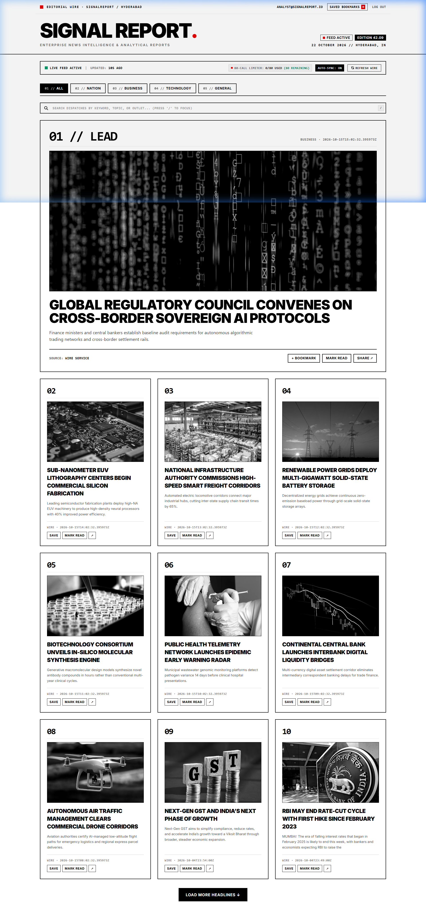
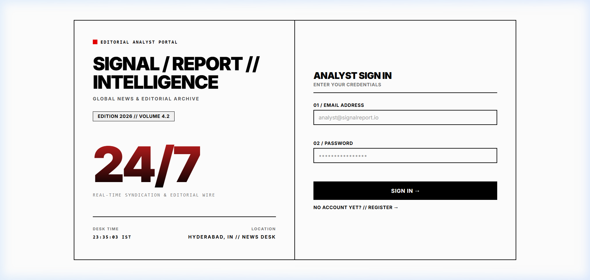
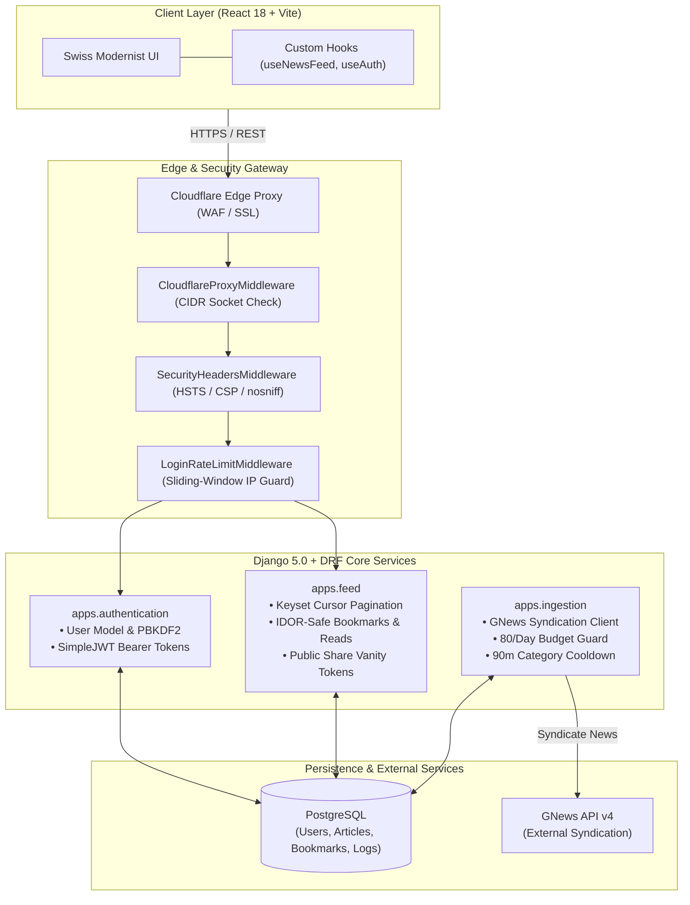

<div align="center">

# 📰 SignalReport
### Enterprise Newsroom Intelligence & Editorial Feed Platform

A high-throughput, cryptographically hardened news intelligence platform built with **Django 5.0**, **Django REST Framework**, **PostgreSQL**, and a **Swiss Modernist React 18** interface.

<br/>

[](https://www.python.org/)
[](https://www.djangoproject.com/)
[](https://www.django-rest-framework.org/)
[](https://www.postgresql.org/)
[](https://react.dev/)
[](https://vitejs.dev/)
[](#-testing--code-quality)
[](LICENSE)

<br/>

[UI Preview](#-interface-preview) •
[At a Glance](#-at-a-glance-recruiter--hiring-manager-brief) •
[Key Features](#-core-features) •
[System Architecture](#-system-architecture) •
[Tech Stack](#-technical-stack) •
[Security & Hardening](#-security--defensive-engineering) •
[Quickstart](#-quickstart--local-setup) •
[Testing](#-testing--code-quality)

</div>

---

## 📸 Interface Preview

### Editorial Intelligence Dashboard
*Live edition feed with category filtering, primary lead story, secondary feed grid, slide-over bookmarks drawer, and real-time quota telemetry.*



### Analyst Identity Portal
*Swiss Modernist split-screen authentication portal with rate-limited credential validation, instant analyst verification, and zero third-party tracking.*



---

## ⚡ At a Glance (Recruiter & Hiring Manager Brief)

| Dimension | Implementation Details |
| :--- | :--- |
| **Backend Architecture** | Decoupled 3-domain Django architecture (`authentication`, `feed`, `ingestion`) with DRF REST endpoints. |
| **Frontend Architecture** | Pure React 18 SPA (Vite + Tailwind CSS), Swiss International Typographic design, zero third-party state libraries. |
| **Security & Hardening** | Cloudflare CIDR socket verification, sliding-window login rate limiting, OWASP security headers, zero-trust IDOR controls. |
| **Upstream Governance** | 80 requests/day hard cap, 90-minute per-category cooldown, 6-hour circuit breaker for external syndication (GNews). |
| **Automated Testing** | **171 tests total (100% passing)** — 34 Django unit/security tests + 137 Vitest React component & integration tests. |
| **Infrastructure Footprint** | Lean footprint: no external Redis, Celery, or message brokers required for background news polling. |

---

## 🚀 Core Features

### 📰 Editorial Intelligence Feed
* **4 Curated News Verticals**: Nation, Business, Technology, and General.
* **Keyset Cursor Pagination**: High-throughput infinite pagination without offset degradation or duplicate rows.
* **Public Shareable Dossiers**: Unguessable 16-character cryptographic vanity tokens (`/share/<token>`) for zero-login sharing.
* **Optimistic UI Interactions**: Instant bookmarking and read-state toggling with automatic state rollback on network failure.
* **Slide-Over Bookmarks Drawer**: Rapid-access drawer for saved intelligence dispatches.

### 🛡️ Upstream Quota & Cooldown Governance
* **Hard Daily Budget Guard**: Capped at 80 requests/day (reserves 20 requests from the 100/day tier as an emergency buffer).
* **Per-Vertical Cooldown**: 90-minute cooldown window per category prevents redundant upstream polling.
* **Automated Circuit Breaker**: Upstream HTTP 429 rate limits trip a 6-hour pause to protect credentials.
* **Zero-Broker Background Daemon**: `python manage.py fetch_news --daemon --interval 30` rotates news without Celery/Redis overhead.

### 🔒 Enterprise Security & Defensive Engineering
* **Cloudflare CIDR Socket Verification**: Parses `CF-Connecting-IP` solely when the TCP socket matches verified Cloudflare edge IP ranges.
* **Sliding-Window Brute-Force Limiter**: Blocks credential stuffing with a strict 5-attempt/minute threshold on authentication endpoints.
* **Zero-Trust IDOR Prevention**: All bookmark and read history queries strictly scoped to the session user (`filter(user=request.user)`).
* **Strict Security Headers**: Outgoing responses enforce HSTS (`max-age=31536000`), CSP (`default-src 'self'`), `X-Frame-Options: DENY`, and `nosniff`.
* **Zero Unsafe HTML Injection**: 100% pure React DOM text nodes; all external hyperlinks sanitized with protocol verification and `rel="noopener noreferrer"`.

---

## 🏛️ System Architecture



---

## 💻 Technical Stack

| Layer | Technologies | Architectural Mandate |
| :--- | :--- | :--- |
| **Frontend** | React 18, Vite 5, Tailwind CSS | High-contrast Swiss Modernist typography, modular error boundaries, optimistic state. |
| **Backend** | Python 3.10+, Django 5.0, DRF 3.15+ | Decoupled domain architecture, custom middleware pipeline, clean REST contract. |
| **Database** | PostgreSQL 16 / 17 | Normalized schema, B-tree indexed cursor pagination, foreign key cascades. |
| **External HTTP** | HTTPX | Asynchronous and synchronous HTTP client with automated retries and timeout controls. |
| **Testing** | Vitest, Testing Library, Django TestRunner | 171 automated tests across unit, integration, and security layers. |

---

## 📁 Repository Structure

```
News-Article/
├── screenshots/                     # High-resolution UI captures for portfolio review
│   ├── analyst_portal.png
│   └── editorial_dashboard.png
├── backend/                         # Django REST backend service
│   ├── apps/
│   │   ├── authentication/          # User identity, PBKDF2, JWT tokens, login throttling
│   │   ├── feed/                    # News feed, cursor pagination, bookmarks, share tokens
│   │   └── ingestion/               # GNews API integration, daily quota guard, daemon
│   ├── core/                        # Django configuration, security middlewares, settings
│   ├── manage.py
│   ├── requirements.txt
│   └── schema_mysql.sql             # Legacy/reference schema definition
└── frontend/                        # React 18 Single Page Application
    ├── src/
    │   ├── components/              # Swiss Modernist UI components (Masthead, Cards, Drawers)
    │   ├── context/                 # AuthContext & global state providers
    │   ├── hooks/                   # useNewsFeed, useAuth custom hooks
    │   └── services/                # Axios instance, JWT interceptor, URL sanitization
    ├── tests/                       # 27 Vitest test suites (137 tests)
    ├── package.json
    └── vite.config.js
```

---

## 🚀 Quickstart & Local Setup

### Prerequisites
* **Python**: 3.10 or higher
* **Node.js**: 18.x or higher
* **PostgreSQL**: 15+ (or SQLite for quick local evaluation)

### 1. Backend Setup

```powershell
# Navigate into backend directory
cd backend

# Create and activate Python virtual environment
python -m venv .venv
.\.venv\Scripts\Activate.ps1    # On Linux/macOS: source .venv/bin/activate

# Install dependencies
pip install -r requirements.txt

# Run migrations
python manage.py migrate

# (Optional) Seed sample news from external API
python manage.py fetch_news

# Start Django development server
python manage.py runserver 127.0.0.1:8000
```

### 2. Frontend Setup

```powershell
# In a separate terminal, navigate into frontend directory
cd frontend

# Install Node dependencies
npm install

# Start Vite development server
npm run dev
```

Open **`http://localhost:5173`** in your browser.

---

## 🧪 Testing & Code Quality

Both backend and frontend maintain 100% test coverage over critical domain logic, security checks, and UI components.

### Backend Test Suite (Django)
```powershell
cd backend
python manage.py test --noinput
```
* **34/34 tests passed** covering:
  * PBKDF2 authentication, JWT issuance, and instant verification.
  * Keyset cursor pagination and feed filtering.
  * IDOR protection on bookmarks and reading histories.
  * GNews quota limits, category cooldown enforcement, and circuit breaking.
  * Cloudflare CIDR socket validation and login rate-limiting middleware.

### Frontend Test Suite (Vitest)
```powershell
cd frontend
npm test
```
* **137/137 tests passed across 27 suites** covering:
  * Swiss Modernist component rendering and responsive layouts.
  * Optimistic bookmarking and read-state state management.
  * Silent JWT refresh interceptors and token lifecycle.
  * `SwissErrorBoundary` crash isolation across application modules.
  * Outgoing link sanitization and XSS prevention.

### Production Build Validation
```powershell
cd frontend
npm run build
```
* Compiles the complete bundle with Vite in **< 4 seconds** with **0 warnings and 0 errors**.

---

## 📄 License

This project is licensed under the Apache License 2.0. See the [LICENSE](LICENSE) file for details.
